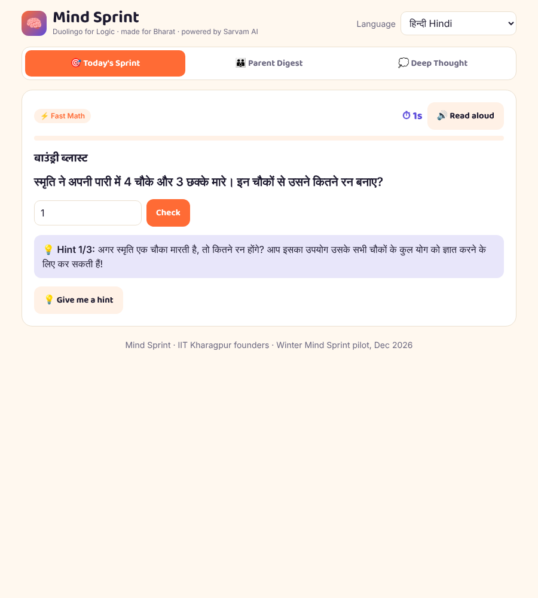
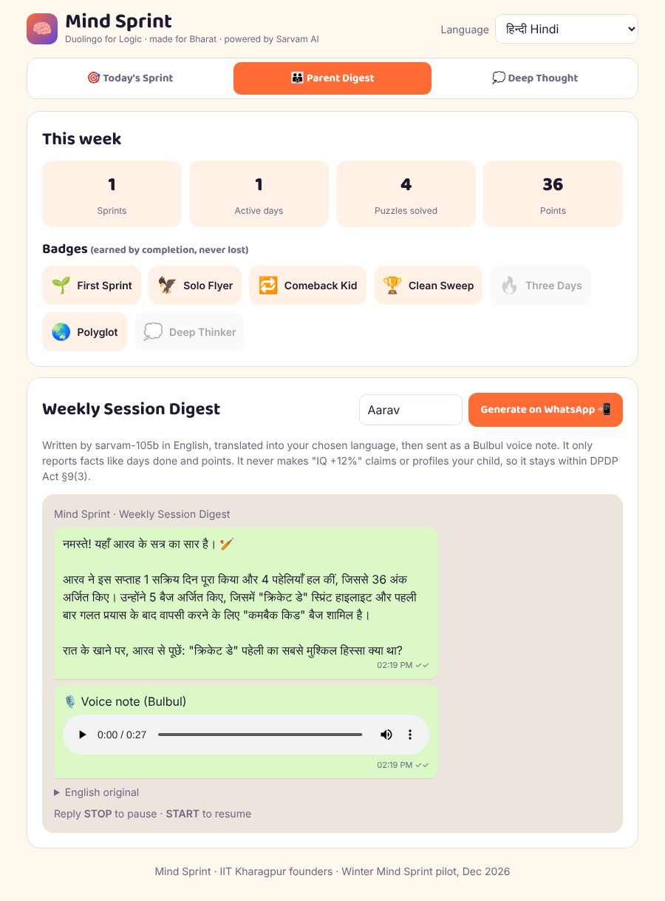

# 🧠 Mind Sprint — Duolingo for Logic, made for Bharat

A daily 7-minute brain sprint for Indian kids aged 8-14. Parents receive the link on WhatsApp, and the child solves four auto-graded puzzles: **Fast Math, Logic & Matrix, Riddle, Curiosity**. Each week parents get a **Session Digest** in their own language, with a voice note.

Built for the Sarvam campus hackathon. All of the AI runs on **Sarvam AI**.

| Feature | Sarvam API |
|---|---|
| Fresh AI-written daily sprint on any theme | `sarvam-105b` chat completions |
| ✅ Answer checker: a second `sarvam-105b` pass solves every generated puzzle without seeing the answer, and disagreements are swapped for curated items | `sarvam-105b` (reasoning) |
| Puzzles in 11 languages (Hindi, Tamil, Bengali, Telugu, …) | Sarvam Translate (`sarvam-translate:v1`) |
| 🔊 Read-aloud for younger or slower readers | Bulbul v3 text-to-speech |
| 💡 Socratic hints that never reveal the answer | `sarvam-105b` (plus a server-side answer-leak guard) |
| 👪 Weekly parent digest in the parent's language plus a voice note | `sarvam-105b` → Translate → Bulbul v3 |
| 💭 Ungraded "Deep Thought": the kid **speaks** a reflection in any language | Saarika speech-to-text → `sarvam-105b` |

## Run it

```bash
export SARVAM_API_KEY=your_key   # or put SARVAM_API_KEY=... in .env (git-ignored)
node server.js                   # Node 18+, zero npm dependencies
open http://localhost:3000
```

On startup the server pre-generates and checks sprints (cricket, space, monsoon, surprise me), so **Generate** answers instantly on stage. If the API is unreachable, the app falls back to a curated, hand-checked 5-day puzzle bank (`public/puzzles.json`).

## Design choices taken from our strategy brief

- **Completion badges, not streaks.** Missing a day never takes anything away, unlike LogIQids' streak mechanic.
- **The digest reports facts only.** It shows days, puzzles and points, with no "IQ +12%" claims and no profiling of minors (DPDP Act 2023 §9(3)). The prompt forbids inventing skills or comparing children.
- **No install.** It's a link, compared with a ~144MB competitor app.
- **The API key stays server-side.** The browser only talks to `server.js`.

See [PITCH.md](PITCH.md) for the pitch and the 2-minute demo script.

## Screenshots

| Socratic hint in Hindi | Parent digest + voice note |
|---|---|
|  |  |
